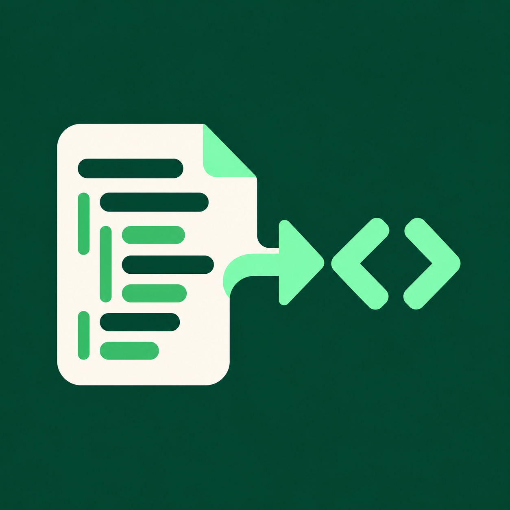

# Pseudo / Studio

Entorno local para escribir pseudocódigo en español, analizarlo con lexer/parser/semántica reales, generar Python y JavaScript, ejecutarlos en un runtime OCI aislado, crear pruebas, guardar proyectos SQLite y exportar resultados.

## Requisitos

- Python 3.12.x, npm 10+, Node.js 22+.
- Docker compatible con un daemon rootless, o Docker Desktop integrado con WSL2. El chequeo rechaza daemon rootful fuera de una VM WSL2 comprobable, imágenes ausentes, seccomp no íntegro o controles internos fallidos.
- Linux con daemon OCI rootless, Windows con Docker Desktop integrado en WSL2, o macOS con Docker Desktop. En todas las plataformas el runner exige una frontera rootless o un kernel Docker Desktop identificable (`linuxkit`/WSL2) y verifica los controles dentro de ambos runtimes. La integración realmente ejecutada en este workspace es WSL2; macOS aún requiere validación en esa plataforma. Los servicios escuchan solo en loopback.
- Espacio para las imágenes runtime OCI de Python y Node (descargadas por digest en la primera ejecución).

## Preparar y arrancar

Desde la raíz del repositorio:

```sh
python3.12 scripts/manage.py bootstrap
python3.12 scripts/manage.py verify
python3.12 scripts/manage.py start
python3.12 scripts/manage.py smoke
```

Abre <http://127.0.0.1:5173>. La documentación OpenAPI local está en <http://127.0.0.1:8000/api/v1/docs>. Para cerrar los procesos administrados, ejecuta `python3.12 scripts/manage.py stop`.

`bootstrap` crea `.venv`, instala `requirements.lock`, instala el paquete local, ejecuta `npm ci` e instala Chromium para Playwright. Descarga dependencias de PyPI/npm y las imágenes OCI fijadas; no necesita cuenta ni servicios de nube. Para cambiar el índice Python:

```sh
PSEUDO_PYPI_INDEX=https://pypi.org/simple python3.12 scripts/manage.py bootstrap
```

En Windows abre la distribución WSL2 que tiene Docker Desktop integration y ejecuta los mismos comandos Linux desde el repositorio en ese entorno. En macOS, ejecuta los comandos en Terminal después de iniciar Docker Desktop; `verify` comprueba que el daemon pertenece a su VM Linux antes de habilitar `run`.

Si el runtime informa sandbox degradado, no habilita la ejecución: confirma Docker Desktop > Settings > Resources > WSL Integration, o instala y activa Docker rootless. `verify` muestra cada control que no pasó. No se debe sustituir por un daemon rootful nativo ni ejecutar el código generado fuera del contenedor. Consulta las [instrucciones oficiales de Docker rootless](https://docs.docker.com/engine/security/rootless/) si falta el engine.

## Uso y API

1. Escribe o abre `.psc`; **Analizar** genera tokens, AST, símbolos, spans y diagnósticos a partir del compilador.
2. **Traducir** produce archivos Python y JavaScript independientes, junto con hashes y mapas de líneas.
3. **Consola** ejecuta ambos targets en contenedores aislados, permite entrada interactiva por WebSocket y cancelación efectiva.
4. **Pruebas** corre los ejemplos oficiales A–E o casos propios en ambos runtimes y compara stdout/stderr/estado. El informe conserva los diffs crudos Python↔Node y presenta aparte la equivalencia que solo normaliza CRLF/CR a LF.
5. **Proyectos** guarda código en SQLite, conserva versiones e historial de ejecución y permite recuperar el proyecto tras recargar.
6. Exporta fuentes, generadores, AST, símbolos, diagnósticos y reportes JSON/Markdown/PDF desde los paneles correspondientes.

La fuente académica revisada es `Context/fase_1.pdf`; sus programas y datasets están en `examples/`. La gramática implementada y sus decisiones se documentan en `docs/gramatica.ebnf` y `docs/DECISIONS.md`.

La API versionada usa el prefijo `/api/v1`; su contrato OpenAPI está en <http://127.0.0.1:8000/api/v1/docs>. Incluye `/health`, `/analyze`, `/translate`, `/run`, `/runs/{run_id}/cancel`, `/tests/run`, `/examples`, `/grammar`, `/projects` y `/exports`. `WS /api/v1/run/interactive` es el canal interactivo. `/health` exige base de datos y runner verificados para declarar `ready`.

## Desarrollo y validación

Para repetir la validación automática desde una instalación limpia en WSL, ejecuta `bash scripts/validate_wsl.sh`. Usa un clon local de HEAD y conserva logs y artefactos en `reports/runs/`. Los prerrequisitos, el procedimiento y los criterios de aprobación están en [docs/WSL_TEST_PLAN.md](docs/WSL_TEST_PLAN.md).

```sh
.venv/bin/ruff check backend scripts
.venv/bin/pre-commit run --all-files
.venv/bin/pip-audit --strict --no-deps --disable-pip -r requirements.lock --format json -o reports/python-dependency-audit.json
npm --prefix frontend audit --audit-level=moderate --json > reports/npm-dependency-audit.json
.venv/bin/pytest -q
python3.12 scripts/benchmark_compile.py
cd frontend
npm run build
npm run test:e2e
cd ..
python3.12 scripts/run_official_acceptance.py
```

El runner y pruebas end-to-end requieren OCI disponible y verificado. La aceptación emite detalle de entradas, expected/actual, salida, stderr, estado, duración y hashes en `reports/acceptance-results.json` y `.md`. El benchmark registra percentiles medidos para análisis de 100 y 1.000 líneas en `reports/compiler-performance.json` y `.md`. Consulta `docs/IMPLEMENTATION_STATUS.md` y `docs/TRACEABILITY.md` para el estado observado; los pasos precisos para cerrar las verificaciones externas están en `docs/REMAINING_GATES.md`. Una casilla solo se marca cuando existe evidencia reproducible.

## Persistencia y privacidad local

El backend usa `data/projects.sqlite3`, WAL, transacciones y migraciones; la carpeta `data/` no se versiona. Respalda la base activa con `python3.12 scripts/manage.py backup` (o `--output ruta.sqlite3`); verifica `PRAGMA quick_check`. No se envían fuentes, entradas, proyectos ni telemetría a servicios externos. Los procesos se enlazan a `127.0.0.1`. Copia `.env.example` a `.env` y ajusta cuotas; reinicia API para aplicarlas. Las fuentes ejecutadas nunca reciben red, sockets del host, secretos ni el directorio personal.

## Estructura

- `backend/compiler`: lexer, Pratt parser, AST, semántica y generadores.
- `backend/runtime`: runner OCI, cuotas, aislamiento y sesiones batch/interactivas.
- `backend/app`: API, contratos, proyectos y exportación.
- `backend/tests`: unitarias, integración, API y seguridad.
- `frontend`: interfaz React/TypeScript/CodeMirror y Playwright E2E.
- `examples`: fuente y entradas oficiales A–E.
- `sandbox`: digests de imágenes y perfil seccomp fijado.
- `docs`: gramática, trazabilidad, decisiones, manual y estado del plan.
- `reports`: resultados de aceptación y evidencia generada.
