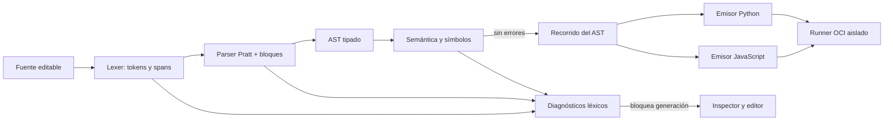

# Construcción y recorrido del AST

## Ejemplo de entrada

```text
Inicio
x = 1 + 2 * 3
Escribir x
Fin
```

El lexer convierte la segunda línea en identificador, asignación, tres números y operadores. El parser Pratt aplica la precedencia formal: `*` se agrupa antes que `+`. La forma esencial del AST serializado es:

```text
Program
└─ body[1] → Assign
   ├─ target → Name(identifier="x")
   └─ value → Binary(operator="+")
      ├─ left → Literal(value=1.0, inferred_type="number")
      └─ right → Binary(operator="*")
         ├─ left → Literal(value=2.0, inferred_type="number")
         └─ right → Literal(value=3.0, inferred_type="number")
└─ body[2] → Write
   └─ values[1] → Name(identifier="x", inferred_type="number")
```

Los nombres `Program`, `Assign`, `Binary`, `Literal`, `Write` y `Name` son las clases serializadas por `backend/compiler/model.py`. Los campos `operator`, `value`, `identifier` e `inferred_type` provienen de los nodos reales; `left`, `right`, `target`, `value`, `body` y `values` son relaciones del modelo, no nodos inventados por la vista.

## Del texto al código



`compile_source` encadena estas fases. `SemanticAnalyzer` asigna tipos inferidos a expresiones y construye la tabla con ámbito global o `function:nombre`. Solo si no hay diagnósticos de error los dos generadores reciben el AST validado. Cada emisor visita nodos (`Assign`, `If`, `For`, `While`, `Dimension`, `Function`, `Return`, etc.) y produce código y mapas de fuente. Los helpers de entrada, salida, arreglos, errores y formato numérico se añaden alrededor del programa fuente; no sustituyen el recorrido.

Para el ejemplo, las vistas abreviadas `program_source` producidas actualmente son:

```python
x = (1.0 + (2.0 * 3.0))
__ps_write(x)
```

```javascript
let x;
x = (1 + (2 * 3));
__ps_write(x);
```

Las versiones completas incorporan sus auxiliares de runtime. Los decimales explícitos en Python mantienen la misma representación IEEE-754 que JavaScript; el helper de escritura normaliza la salida visible. Los `source_map` enlazan líneas generadas con el span original. La pestaña de AST muestra atributos escalares y nombres de relaciones, y al seleccionar un nodo enfoca la fuente con conversión de offset Unicode para CodeMirror.

### Agrupación de una expresión compuesta

Para `resultado = ((a + b) * c) - (a / b)`, el árbol conserva esta forma:

```text
Binary(operator="-")
├─ left → Binary(operator="*")
│  ├─ left → Binary(operator="+")
│  │  ├─ left → Name("a")
│  │  └─ right → Name("b")
│  └─ right → Name("c")
└─ right → Binary(operator="/")
   ├─ left → Name("a")
   └─ right → Name("b")
```

Los paréntesis controlan la agrupación al analizar; el AST guarda las relaciones resultantes, no nodos de paréntesis. Al generar, cada backend visita primero los hijos y emite expresiones agrupadas con paréntesis donde se necesitan:


Ambos emisores recorren el mismo árbol tipado. El código completo añade helpers de ejecución y los mapas conservan la relación entre línea generada y fuente.

## Error recuperable frente a programa ejecutable

El parser puede conservar un árbol parcial al reportar errores para ayudar a localizar el problema. El servicio mantiene `translatable=false` y no devuelve artefactos si existe un diagnóstico de error. El árbol se presenta junto con el estado de error y nunca habilita el runner. Las pruebas `test_multiple_nested_errors_recover_and_keep_hints_with_exact_spans` y `test_syntax_errors_are_located_and_do_not_emit_ast_as_valid` cubren recuperación y bloqueo.
