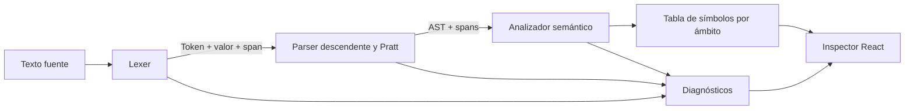

# Informe técnico — Fase 2: análisis y prototipo

**Proyecto:** Pseudo / Studio · **Fecha:** 24 de octubre de 2026\
**Alcance:** analizador léxico, parser/AST, análisis semántico, tabla de símbolos, gestor de errores y prototipo de C/D.\
**Fuentes de autoridad:** `docs/gramatica.ebnf`, `Context/req_fases_1_2_3.pdf` y `docs/REQUERIMIENTOS_FASES_2_3.md`.

## 1. Objetivo y resultado técnico

La Fase 2 verifica que el pseudocódigo definido tenga una estructura procesable por máquina. El compilador transforma texto en tokens con spans, construye nodos de un AST, valida nombres/tipos/inicialización y devuelve símbolos y diagnósticos. El analizador no traduce código inválido.

La solución implementada está en `backend/compiler/`: `lexer.py`, `parser.py`, `semantic.py`, `model.py` y `service.py`. La vista del prototipo está conectada a `/api/v1/analyze` y muestra Tokens, AST, Símbolos, Errores y Fases. El detalle de construcción del árbol y su recorrido está en [AST_Y_Recorrido.md](AST_Y_Recorrido.md).

## 2. Recorrido del análisis

El lexer consume el texto de izquierda a derecha y reconoce palabras reservadas, identificadores Unicode, operadores, números, cadenas, comentarios y saltos. El parser descendente arma sentencias y bloques; el parser Pratt resuelve precedencia y asociación de expresiones. El análisis semántico usa `(scope, nombre)` como clave de símbolo e informa tipo, inicialización, lecturas/escrituras y referencias.

Los ámbitos implementados son global y uno por función. Las variables nacen por asignación o lectura. No se afirma que cada `Si` o ciclo abra un scope nuevo. Las funciones se predeclaran, lo que permite llamadas adelantadas y recursión. Los tipos son `number`, `string`, `boolean`, `array` y `unknown` durante inferencia.

## 3. Gestor de errores

Los diagnósticos contienen fase, código, severidad, mensaje, span y sugerencia. Los errores léxicos señalan caracteres/números/cadenas; los sintácticos señalan tokens o cierres faltantes; los semánticos señalan nombres, tipos, inicialización, funciones, dimensiones o división constante entre cero. Los hints ahora proponen acciones concretas por código y el parser usa la construcción esperada cuando conoce el token faltante.

La recuperación se sincroniza en saltos de línea y terminadores de bloque. La regresión anidada comprueba dos errores sintácticos independientes y uno léxico en un solo programa. `compile_source` conserva el resultado de análisis, marca `translatable=false` y deja `artifacts` vacío ante errores. La UI enfoca el span; para caracteres fuera del plano multilingüe, convierte offsets de puntos de código Python a UTF-16 antes de seleccionar en CodeMirror.

## 4. Casos C y D

Los programas C y D y sus tres datasets por programa son los de `examples/C.psc`, `examples/D.psc` y `examples/official-cases.json`; no se alteran sus algoritmos ni salidas. El panel de Pruebas ejecuta el programa elegido en Python y Node y compara stdout. La aceptación académica pide seis datasets × dos runtimes = 12 ejecuciones.

Los tres datasets de C y los tres de D se ejecutaron en ambos runtimes como parte de la aceptación oficial vigente: **12/12 ejecuciones** (seis por programa), contenidas en las **30/30** A–E de `reports/acceptance-results.json/.md`. Python 3.12.14 y Node v22.22.2 corrieron dentro de OCI; stdout esperado y real coincide, stderr está vacío y exit code es 0. Las capturas reales de interfaz están en `reports/phase2-execution-c.png` y `reports/phase2-execution-d.png`.

## 5. Pruebas y límites de esta revisión

Las pruebas estáticas del compilador/API y el estado de build se registran en [VALIDATION_REPORT.md](VALIDATION_REPORT.md). El conjunto de conformidad de `docs/LANGUAGE_CONFORMANCE_MATRIX.md` relaciona cada familia con su prueba y diagnóstico.

La revalidación de `python3.12 scripts/manage.py verify` detectó Docker Desktop VM disponible, seccomp y cuotas; `manage.py start`/`smoke`/`stop` verificaron API, frontend y runtimes y dejaron los servicios apagados. `.venv/bin/pytest -q` terminó con 94 tests y 91 subtests aprobados. `npm run test:e2e` terminó 10/10 e incluye AST, errores, corrección/reanálisis, exportaciones TXT, A–E desde la UI, navegación y axe. `npm run build`, Ruff y `git diff --check` pasan. Los resultados completos están en [VALIDATION_REPORT.md](VALIDATION_REPORT.md).

## 6. Estado frente a la rúbrica

| Criterio | Implementación observable | Estado de aceptación |
|---|---|---|
| Analizador léxico (20%) | Tokens, lexemas, valores, spans, comentarios, NFC, operadores y errores. | Verificado: pruebas backend, matriz de conformidad y flujo UI en E2E 10/10. |
| AST (20%) | Parser Pratt, nodos tipados, precedencia, spans, recuperación y árbol con campos/relaciones visibles. | Verificado: `AST_Y_Recorrido.md`, pruebas de parser y navegación del árbol en Playwright. |
| Semántica y símbolos (20%) | Tipos, inicialización, funciones, aridad, arrays y scopes global/función. | Verificado: suite backend, casos extendidos y ejecución OCI Python/Node. |
| Gestor de errores (25%) | Código/fase/mensaje/ubicación/hints específicos; generación bloqueada y exportación TXT. | Verificado: negativos con spans, hints, error→corrección→reanálisis E2E y TXT de diagnósticos. |
| Documentación y prototipo C/D (15%) | Este informe, matriz, interfaz y fixtures oficiales. | Verificado técnicamente: C/D 12/12, capturas reales y E2E. El render final del DOCX de Fase 1 y su paginación requieren revisión humana en Word/LibreOffice. |

Esta tabla informa evidencia técnica y no estima la nota del docente. La aplicación demuestra análisis, diagnósticos y ejecución C/D en ambos runtimes. La revisión de formato del documento académico, los nombres reales del equipo y la defensa ante docente siguen siendo tareas humanas.

## 7. Guion de demostración

La secuencia hablada y los clics está en [GUION_DEFENSA_FASE_2.md](GUION_DEFENSA_FASE_2.md). La explicación de gramática, árbol y diagnósticos corresponde al código desplegado y no a una maqueta.
